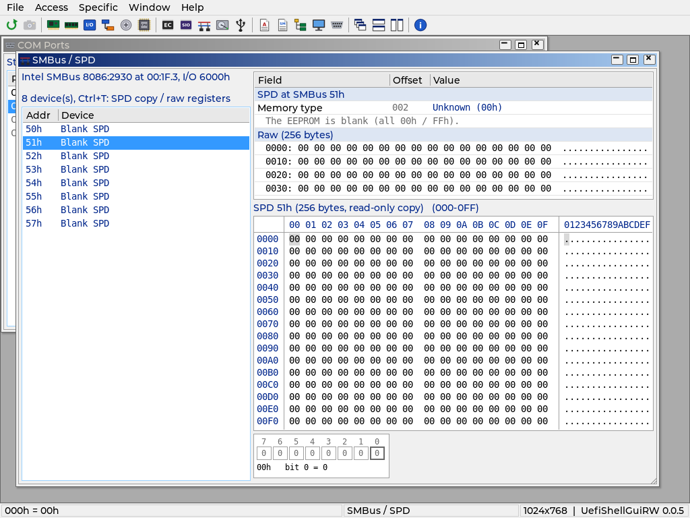
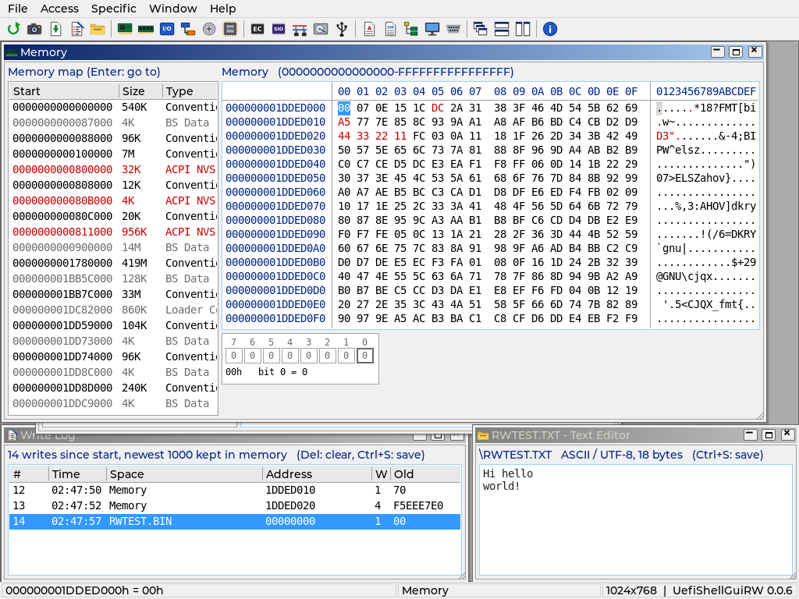

# Module windows

Each module has one window (running its command again brings it to the
front). Windows open at the size their content needs; Window > Cascade
keeps that size. `F5` re-reads the active window. Writes follow the hex
grid rules in [Widgets.md](Widgets.md): typing writes, dangerous writes ask
first with No as the default.

Raw-space windows share `Views/SpaceView.c`: a heading with the space name
and range, the hex grid, and the bit field view of the value under the
cursor (click a bit to toggle it, written through the grid). The status
bar shows the cursor address and value.

## Phase 3

| Window | File | Left / right | Notes |
|---|---|---|---|
| PCI Devices | `Views/PciView.c` | Every function (bridges in blue) / config space | 256 bytes, or 4 KB when extended config space is reachable (`PgDn` for the next pages). BARs, the ROM BAR, bridge bus numbers and windows are dangerous. `Enter` in the list moves to the grid. |
| Memory | `Views/MemoryView.c` | UEFI memory map, adjacent ranges merged / physical memory and MMIO | Opens at 0. `Enter` on a map row jumps there, `Ctrl+G` goes anywhere. ACPI reclaim / NVS (red in the map) and FF000000h-FFFFFFFFh are dangerous. Auto refresh is on. |
| I/O Space | `Views/IoView.c` | Ports 0000h-FFFFh | Reads can have side effects, so no auto refresh. CF9h, 92h and 64h are dangerous. |
| Index/Data | `Views/IndexDataView.c` | Port pairs / registers 00h-FFh | 70h/71h, 72h/73h, 2Eh/2Fh, 4Eh/4Fh, C00h/C01h, CD6h/CD7h and Custom (asks for both ports). Super I/O pairs read FFh until the chip is in config mode (Phase 5 does that). |
| CMOS | `Views/CmosView.c` | CMOS RAM 00h-FFh / RTC decode | 00h-7Fh through 70h/71h, 80h-FFh through 72h/73h, byte access. The decode shows time, date, day, alarm, registers A, B, D and the century byte; register C is not read (reading clears it). |
| CPU MSR | `Views/MsrView.c` | Known MSRs of the boot processor | `Enter` writes a new value, `Ins` adds any MSR by index, the 64-bit bit view toggles bits. Every MSR write asks first. A #GP guard shows unsupported MSRs as `#GP` instead of hanging. |

## Phase 4

Decoder windows: a list or tree on the left, the decode of the selected
item on the right (a property table: field, offset, value; sections are
shaded). Nothing is written.

| Window | File | Left / right | Notes |
|---|---|---|---|
| PCIe Tree | `Views/PcieTreeView.c` | Bridge hierarchy per root bridge / device decode | Header, BARs, bridge windows, capabilities and extended capabilities, PCIe link. `Enter` on a device opens it in PCI Devices; `Enter` on a decoded field opens PCI Devices at that register. |
| ACPI Tables | `Views/AcpiView.c` | Tables from the XSDT (or RSDT) with checksum state / table | FADT, MADT, MCFG, HPET, DMAR decoded; DSDT and SSDT as ASL (method argument counts come from every DSDT/SSDT); `Ctrl+T` switches an AML table between ASL and header + hex. Bad checksums are red. |
| SMBIOS | `Views/SmbiosView.c` | Structures (type, handle, name) / structure | Decoded fields for types 0-4, 7-9, 11-13, 16, 17, 19, 32, 41, then the string set and hex. |
| USB Devices | `Views/UsbView.c` | Controller -> port -> device tree / controller or device | Port states, new / removed marks between scans (held 10 s), device and configuration descriptors, hub port status. `F5` rescans. Only standard read requests are sent. |

## Phase 5

Device windows. Writes that can hurt (every SMBus write, MSR writes on any
CPU, turning the SMBus host on) ask first with No as the default.

| Window | File | Content |
|---|---|---|
| Embedded Controller | `Views/EcView.c` | EC RAM 00h-FFh through 62h / 66h as a hex grid; without an EC only a note (no grid, nothing waits on timeouts). |
| Super I/O | `Views/SioView.c` | Chips on 2Eh / 4Eh with their logical devices (tree) / config registers of the selected LDN or the global registers as a hex grid. |
| COM Ports | `Views/ComView.c` | COM1-COM4 with UART presence and the firmware console / line settings, line and modem status. `L` runs the internal loopback test (nothing on the wire; a port with the firmware console asks first, the console is paused meanwhile). |
| SMBus / SPD | `Views/SmbusView.c` | Devices that answer, with address hints and SPD module summaries / SPD decode above a hex grid. The grid shows the read-only SPD copy (all pages) or, with `Ctrl+T`, the raw registers. `E` turns on a host controller the firmware left off. |
| ATA / NVMe Identify | `Views/StorageView.c` | NVMe controllers with their active namespaces, ATA and ATAPI drives / decoded identify data and raw bytes. `F5` identifies again. |
| Monitor EDID | `Views/EdidView.c` | Displays / EDID decode (vendor, timings, descriptors, extensions, checksums) and raw bytes. |
| CPU MSR (extended) | `Views/MsrView.c` | `Ctrl+Left` / `Ctrl+Right` switch the processor; reads and writes run on that CPU. |

## Phase 6

Tools. Files go next to `UefiShellGuiRW.efi` (or the root of the first
writable volume when that one is read-only), named `PREFIXnnnn.EXT`. Nothing
is written to disk unless the user asks.

| Command | File | What it does |
|---|---|---|
| Save Screenshot (`F12`) | `Tools/Tools.c` | The whole screen read back from GOP as a 24-bit BMP, `SCRnnnn.BMP`. |
| Save Window to File (`Ctrl+S`) | `Tools/Tools.c` | Hex windows: asks start (default the page) and length (up to 1 MB), saves `HEXnnnn.TXT` (hex dump) and `HEXnnnn.BIN`. Other windows: the text of their visible lists, `SAVEnnnn.TXT`. Windows with their own save (Write Log, editors) use it. |
| Dump All to File | `Tools/Tools.c`, `RwDump.c` | PCI, ACPI (with ASL), SMBIOS, USB, Super I/O, SPD (never enables a disabled SMBus host), ATA / NVMe identify, EDID, known MSRs on every CPU, `DUMPnnnn.TXT`. |
| Snapshots (hex grids) | `Widgets/HexGrid.c` | `Ctrl+N` takes a snapshot of the page and saves `SNAPnnnn.BIN`; bytes that differ stay red on every read until `Ctrl+N` clears it. `Ctrl+L` loads `SNAPnnnn.BIN` by number (for example to compare across a reboot). |
| Write Log | `Tools/WriteLogView.c` | Every write of the session: time, space, address, width, old value (`--` where reading has side effects), new value, status. Updates itself; `Del` clears; `Ctrl+S` saves `WLOGnnnn.TXT`. |
| File Browser | `Tools/FileView.c` | Volumes / folder (name, size, date). `Enter` opens a folder or a file, `Backspace` goes up. |
| Text / Hex Editor | `Tools/FileEdit.c` | Text files up to 64 KB (ASCII / UTF-8, UCS-2 with BOM; CRLF kept) in a text editor, anything else up to 16 MB in a hex grid. Edits stay in memory; `Ctrl+S` asks, then replaces the file; closing a changed file asks. No delete or rename. |

## Tests

`SelfTestTools.c`: snapshot on a buffer the test allocated (a change stays
red, cleared, loaded back by number), the write log entry of a grid write,
hex range save (TXT + BIN), the Write Log window following new writes and
its save, `F12` BMP header against the screen size, Dump All sections (ASL,
the NVMe serial, both CPUs), generic Save Window, and the File Browser with
the text editor (typing, close asks, save with CRLF) and the hex editor.

`SelfTestDevices.c` runs on a q35 machine with two CPUs, the AHCI disk and a
64 MiB NVMe drive (serial RWNVME01): EC and Super I/O notes, COM1 settings
(COM1 carries the test log, so it is never put in loopback), enabling the
SMBus host and the eight SPD EEPROMs, `Ctrl+T`, NVMe and ATA identify, the
QEMU EDID and the AP's IA32_APIC_BASE.

`SelfTestDecoders.c` checks the PCIe Tree (decode, PCI Express capability,
both jumps into PCI Devices), ACPI (checksums, FADT fields, DSDT as ASL,
`Ctrl+T`, focus skipping the hidden pane), SMBIOS (System Information
strings, End-of-Table) and USB (xHCI, the QEMU keyboard / tablet
descriptors, rescan keeps the selection).

`SelfTestViews.c` opens all six windows through their commands and drives
them with keys: device selection, BAR write cancelled, memory map jump,
`Ctrl+G` and typed writes into a page the test allocated, CF9h write
cancelled, custom Index/Data pair, CMOS writes to spare bytes 38h/39h,
adding MSRs and writing IA32_PAT back with its own value.

