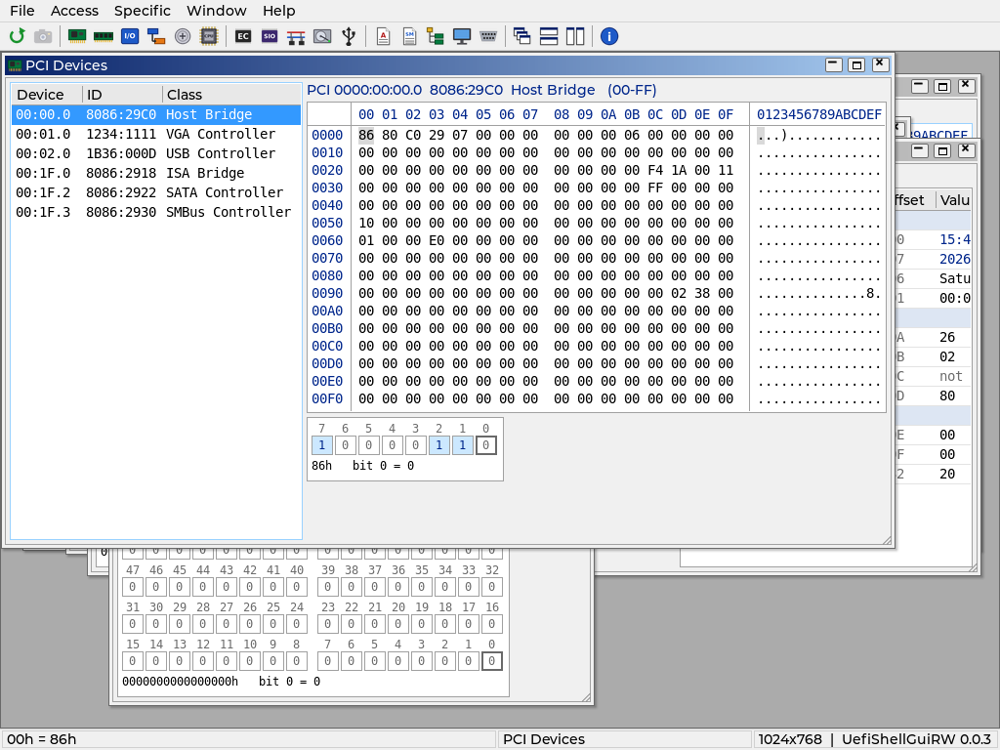
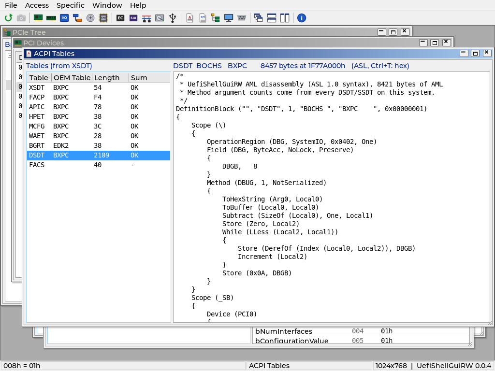

# Module windows

Each module has one window (running its command again brings it to the
front). Windows open at the size their content needs; Window > Cascade
keeps that size. `F5` re-reads the active window. Writes follow the hex
grid rules in [Widgets.md](Widgets.md): typing writes, dangerous writes ask
first with No as the default.

Raw-space windows share `Views/SpaceView.c`: a heading with the space name
and range, the hex grid, and the bit field view of the value under the
cursor (click a bit to toggle it, written through the grid). The status
bar shows the cursor address and value.

## Phase 3

| Window | File | Left / right | Notes |
|---|---|---|---|
| PCI Devices | `Views/PciView.c` | Every function (bridges in blue) / config space | 256 bytes, or 4 KB when extended config space is reachable (`PgDn` for the next pages). BARs, the ROM BAR, bridge bus numbers and windows are dangerous. `Enter` in the list moves to the grid. |
| Memory | `Views/MemoryView.c` | UEFI memory map, adjacent ranges merged / physical memory and MMIO | Opens at 0. `Enter` on a map row jumps there, `Ctrl+G` goes anywhere. ACPI reclaim / NVS (red in the map) and FF000000h-FFFFFFFFh are dangerous. Auto refresh is on. |
| I/O Space | `Views/IoView.c` | Ports 0000h-FFFFh | Reads can have side effects, so no auto refresh. CF9h, 92h and 64h are dangerous. |
| Index/Data | `Views/IndexDataView.c` | Port pairs / registers 00h-FFh | 70h/71h, 72h/73h, 2Eh/2Fh, 4Eh/4Fh, C00h/C01h, CD6h/CD7h and Custom (asks for both ports). Super I/O pairs read FFh until the chip is in config mode (Phase 5 does that). |
| CMOS | `Views/CmosView.c` | CMOS RAM 00h-FFh / RTC decode | 00h-7Fh through 70h/71h, 80h-FFh through 72h/73h, byte access. The decode shows time, date, day, alarm, registers A, B, D and the century byte; register C is not read (reading clears it). |
| CPU MSR | `Views/MsrView.c` | Known MSRs of the boot processor | `Enter` writes a new value, `Ins` adds any MSR by index, the 64-bit bit view toggles bits. Every MSR write asks first. A #GP guard shows unsupported MSRs as `#GP` instead of hanging. |

## Phase 4

Decoder windows: a list or tree on the left, the decode of the selected
item on the right (a property table: field, offset, value; sections are
shaded). Nothing is written.

| Window | File | Left / right | Notes |
|---|---|---|---|
| PCIe Tree | `Views/PcieTreeView.c` | Bridge hierarchy per root bridge / device decode | Header, BARs, bridge windows, capabilities and extended capabilities, PCIe link. `Enter` on a device opens it in PCI Devices; `Enter` on a decoded field opens PCI Devices at that register. |
| ACPI Tables | `Views/AcpiView.c` | Tables from the XSDT (or RSDT) with checksum state / table | FADT, MADT, MCFG, HPET, DMAR decoded; DSDT and SSDT as ASL (method argument counts come from every DSDT/SSDT); `Ctrl+T` switches an AML table between ASL and header + hex. Bad checksums are red. |
| SMBIOS | `Views/SmbiosView.c` | Structures (type, handle, name) / structure | Decoded fields for types 0-4, 7-9, 11-13, 16, 17, 19, 32, 41, then the string set and hex. |
| USB Devices | `Views/UsbView.c` | Controller -> port -> device tree / controller or device | Port states, new / removed marks between scans (held 10 s), device and configuration descriptors, hub port status. `F5` rescans. Only standard read requests are sent. |

## Tests

`SelfTestDecoders.c` checks the PCIe Tree (decode, PCI Express capability,
both jumps into PCI Devices), ACPI (checksums, FADT fields, DSDT as ASL,
`Ctrl+T`, focus skipping the hidden pane), SMBIOS (System Information
strings, End-of-Table) and USB (xHCI, the QEMU keyboard / tablet
descriptors, rescan keeps the selection).

`SelfTestViews.c` opens all six windows through their commands and drives
them with keys: device selection, BAR write cancelled, memory map jump,
`Ctrl+G` and typed writes into a page the test allocated, CF9h write
cancelled, custom Index/Data pair, CMOS writes to spare bytes 38h/39h,
adding MSRs and writing IA32_PAT back with its own value.

