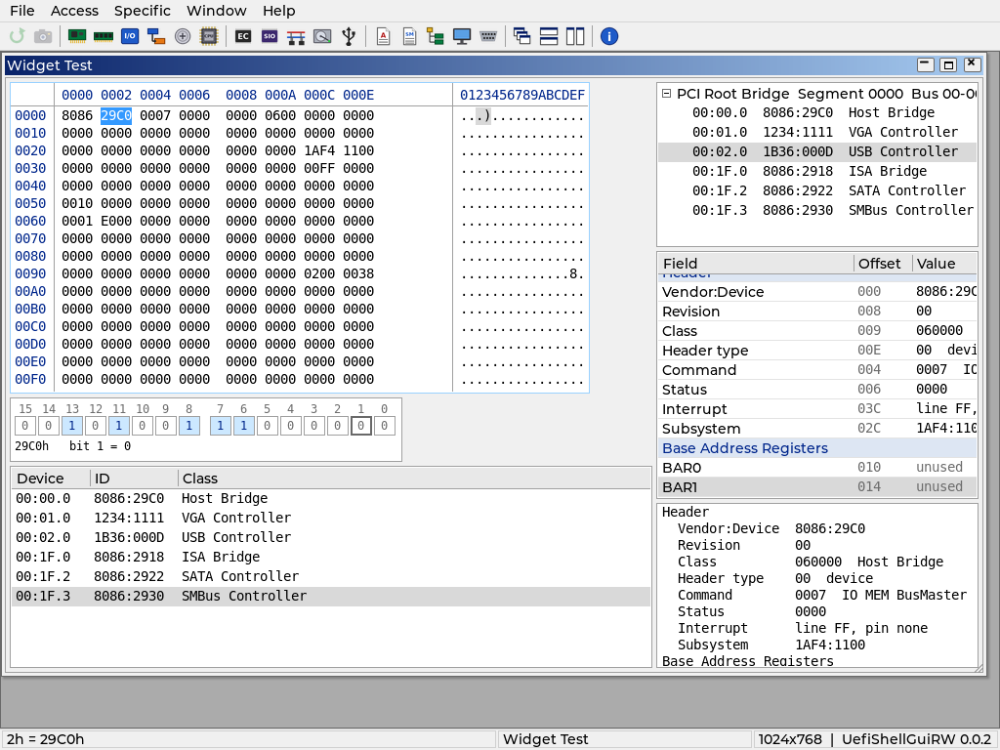

# Widgets (Phase 2)

`UefiShellGuiRWPkg/Application/UefiShellGuiRW/Widgets/` holds the building
blocks every module view uses. `RwWidgets.h` is the only header.

| Widget | File | What it shows |
|---|---|---|
| HexGrid | HexGrid.c | One 256-byte page of an `RW_DATA_SOURCE`: address column, 16 bytes per row as byte / word / dword cells, ASCII column |
| BitFieldView | BitField.c | The bits of one 8-64 bit value as boxes, highest bit first, rows of 16 |
| VList | VList.c | Engine of the lists below: fixed-height rows drawn on demand (only the visible rows cost anything), optional column header. Text wider than the list (last column, tree rows, property values) scrolls sideways with Left / Right (Shift+Left / Shift+Right in a tree), the scroll bar or dragging |
| TreeView | InfoViews.c | An `RW_INFO` as a tree: a row followed by deeper rows gets a [+]/[-] box |
| PropTable | InfoViews.c | An `RW_INFO` as Field / Offset / Value; sections are shaded group rows |
| Table | InfoViews.c | String cells under column headers (device lists) |
| TextView | InfoViews.c | Read-only monospace text (ASL, dumps), horizontal scrolling |
| Dialogs | Dialog.c | Message, Yes / No, hex number entry; modal and asynchronous |

## Keyboard

No LVGL group is used. `RwKeyHandler` passes each key to, in order:

1. the open dialog (it takes every key while open);
2. the menu bar (`F10`, `Alt+letter`, keys while a menu is open);
3. global shortcuts (`Alt+X`, `Ctrl+F4`, `Ctrl+Tab`, `F1`, `F5`, `F12`);
4. the focused widget of the active child window (`RwFocusHandleKey`);
   `Tab` / `Shift+Tab` move the focus inside the window.

Every widget embeds `RW_WIDGET` (object, window, key and focus callbacks)
and joins its window's focus chain with `RwFocusAdd`; a click on it focuses
it. `RwMdiClose` detaches the widgets (`RwFocusWindowClosed`) before the
window is freed; the LVGL objects are deleted asynchronously and each
widget frees itself on `LV_EVENT_DELETE`.

## Hex grid behaviour

- The page is read in the view width (register blocks care about access
  width); a cell the source cannot read in that width is read byte by byte,
  so one unreadable byte shows `--` without hiding its neighbours.
- Values that differ from the previous read of the same page are red.
- Typing hex digits edits the cell under the cursor; the value is written
  when the last digit is typed and the cursor moves on. `Enter` writes a
  partial value, `Esc` cancels, `Backspace` removes a digit.
- Writes the source reports as dangerous (`RwDsIsDangerous`) open a
  warning Yes / No dialog with No as the default.
- Auto refresh (1 s) is on by default for sources without side effects
  (`SideEffects` FALSE) and off otherwise; `Ctrl+R` toggles it.
- `RwHexGridWrite` writes through the same path (used by the bit field
  view).

## Fonts

DejaVu Sans Mono 12 and 14 px (`FontMono12.c`, `FontMono14.c`), generated
with lv_font_conv by `scripts/gen-fonts.sh` (ASCII plus `·` and `…`, 4 bpp).
`RwMonoFont()` returns 12 px on screens narrower than 1024 pixels.

## Tests

`SelfTestWidgets.c` opens the widget test window (`Views/WidgetTest.c`):
a hex grid over a 512-byte test pattern with an unreadable byte (30h) and
a dangerous range (10h-13h), its bit field view, a PCI device table, the
PCI tree, the host bridge decode as a property table and as text. It
drives everything with keys and leaves the window up for the screenshot.
