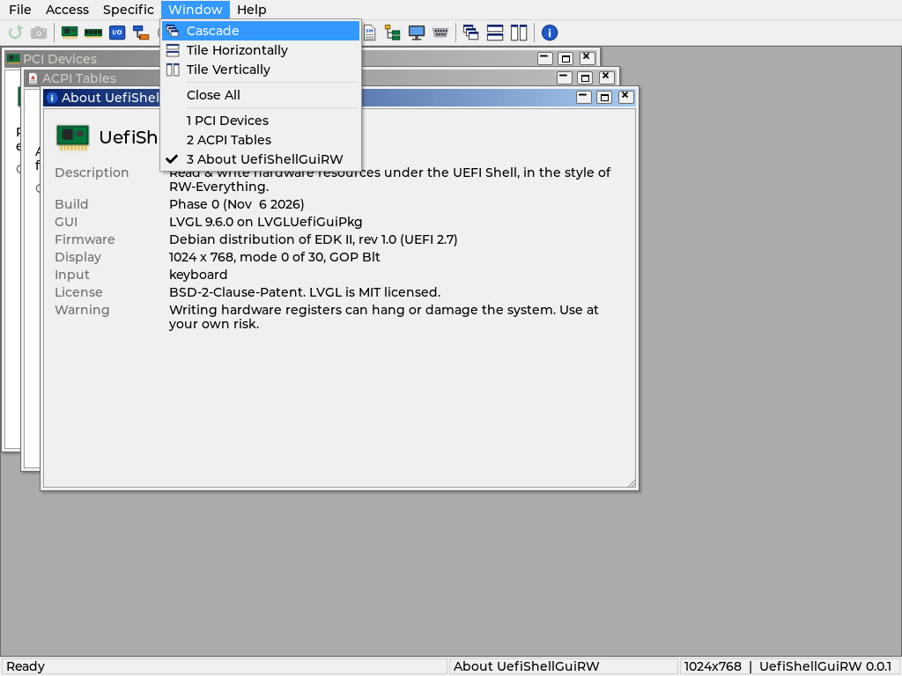

# UefiShellGuiRW

Read & write hardware resources under the UEFI Shell, with a mouse-driven GUI
in the style of [RW-Everything](http://rweverything.com/) for Windows.

The GUI runs on [LVGLUefiGuiPkg](https://github.com/weinet000210/LVGLUefiGuiPkg)
(LVGL v9 on GOP, keyboard and mouse). The hardware access code comes from
[uefirrw](https://github.com/weinet000210/uefirrw) and moves into a
UI-free library, RwCoreLib ([Docs/RwCoreLib.md](Docs/RwCoreLib.md)).



## ⚠️ Use at your own risk

Once the access modules land, this tool reads and writes hardware registers
directly (PCI config space, memory/MMIO, I/O ports, MSRs, CMOS, EC, Super
I/O). Writes can hang the machine, corrupt firmware settings or damage
hardware. Try it on a test machine first and keep a way to recover the BIOS.

## Status

Development happens in phases. A phase is complete when it builds with GCC
and VS2022 and its tests pass in CI (QEMU + OVMF).

| Phase | Content | Status |
|---|---|---|
| 0 | Skeleton: package, LVGLUefiGuiPkg submodule, build scripts, CI; RW-style main window (menu bar, toolbar, MDI desktop, status bar), child window manager, self test | Done |
| 1 | RwCoreLib: hardware access and table parsers ported from uefirrw, no UI; RwCoreTest checks it in QEMU | Done |
| 2 | Common widgets: HexGrid over a DataSource (byte/word/dword, edit, auto refresh), bit field view, tree, property table, dialogs | Planned |
| 3 | Raw spaces: PCI list + config space, Memory, I/O, Index/Data, CMOS, CPU MSR | Planned |
| 4 | Decoders: PCI capabilities, PCIe tree, ACPI + ASL, SMBIOS, USB | Planned |
| 5 | Devices: Super I/O, EC, COM port; SMBus/SPD, ATA/NVMe identify, EDID, MSR per CPU | Planned |
| 6 | Tools: screenshot, dump all, register snapshots and compare, write log, file browser/editor | Planned |
| 7 | Real hardware validation, performance, v1.0 | Planned |

Write policy (from Phase 3): ordinary registers are written when you confirm
the edit; dangerous ones (CF9h reset, MSRs, BARs, bridge bus numbers,
SPI/ACPI regions) ask for confirmation first.

## Using it

```
FS0:\> UefiShellGuiRW.efi
```

| Key | Action |
|---|---|
| `F10`, `Alt+F/A/S/W/H` | Open a menu; arrows move, `Enter` runs, `Esc` closes |
| `Ctrl+Tab` | Next child window |
| `Ctrl+F4` | Close the active child window |
| `F1` | About |
| `Alt+X` | Exit |

Mouse: drag a window by its caption, resize from the bottom-right corner,
double-click the caption to maximize, use the caption buttons to minimize,
maximize or close. Hovering a toolbar button shows its name in the status
bar. OVMF has no USB mouse driver; load `UsbMouseDxe.efi` (built with the
package) first if the pointer is missing.

`UefiShellGuiRW.efi -selftest` runs the built-in frame test and prints
`UEFISHELLGUIRW: PASS` or `FAIL`.

`RwCoreTest.efi` checks the hardware library against a QEMU q35 machine
(PCI, PCIe root port, memory/I/O/CMOS, MSR, SMBIOS, ACPI and the AML
disassembler, USB, COM1) and prints `RWCORETEST: PASS` or `FAIL`:

```sh
UefiShellGuiRW/LVGLUefiGuiPkg/scripts/run-qemu.sh \
  Build-rw/Build/UefiShellGuiRWPkg/DEBUG_GCC/X64/RwCoreTest.efi --smoke RWCORETEST \
  -device pcie-root-port,id=rp1,chassis=1 -device virtio-rng-pci,bus=rp1
```

## Building

```sh
git clone --recursive https://github.com/weinet000210/UefiShellGuiRW.git
EDK2_DIR=~/edk2 UefiShellGuiRW/scripts/build.sh DEBUG RELEASE
UefiShellGuiRW/LVGLUefiGuiPkg/scripts/run-qemu.sh \
  Build-rw/Build/UefiShellGuiRWPkg/DEBUG_GCC/X64/UefiShellGuiRW.efi
```

Windows (VS2022): `set EDK2_DIR=C:\src\edk2`, `set NASM_PREFIX=C:\Program Files\NASM\`,
then `UefiShellGuiRW\scripts\build.bat DEBUG`.

Requirements: edk2-stable202608 with BaseTools built, GCC 5+ or VS2022,
NASM, Python 3. See [Docs/Architecture.md](Docs/Architecture.md) for the
design.

## License

BSD-2-Clause-Patent (see [LICENSE](LICENSE)). LVGL is MIT licensed. The
toolbar icons are original drawings generated by `scripts/gen-icons.py`.
RW-Everything is a separate product; this project is not affiliated with it.
